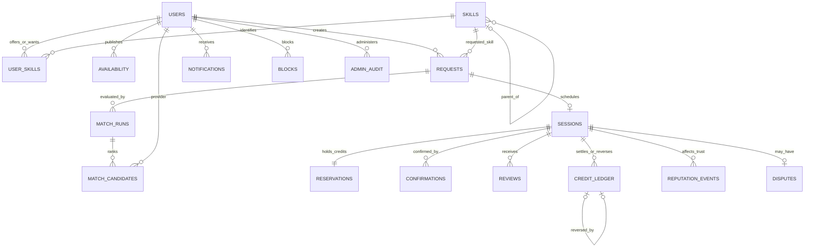

# SkillSwap database design

## Entity relationships



The Mermaid source is suitable for a Markdown viewer or report export. The migrations contain the authoritative complete schema; the first migration creates 18 tables and the second installs integrity triggers. `alembic_version` tracks the schema version.

## Normalization and deliberate derivations

User attributes reside in `users`; skill attributes reside in `skills`. `user_skills` uses the composite key `(user_id, skill_id, kind)`, so proficiency depends on the whole offered/wanted relationship. There are no repeated `skill1`, `skill2` columns. Each skill has one optional parent, with API checks preventing cycles.

Requests, sessions, confirmations and reviews model different facts: intent, scheduled exchange, participant evidence and feedback. Reviews have a unique `(session_id, reviewer_id)` constraint. One accepted request has at most one session; an unaccepted request has none. A session has two possible participant confirmations.

Spendable balances are derived from incoming and outgoing immutable credit ledger entries. Reserved minutes are derived from held reservations; contribution minutes come from settled teaching sessions. No editable balance column can drift from ledger history. Overall and skill-specific reputation are derived from dated immutable reputation events rather than stored caches requiring periodic synchronization.

Matching runs save weights and component scores as deliberate historical snapshots. These snapshots remain explainable when profiles or configuration later change. Session participant and offered-skill fields preserve the accepted exchange; the service sets them from the request, not from arbitrary client input.

## Constraints, triggers and indexes

- Foreign keys preserve relationships. IDs are UUID strings; all timestamps are timezone-aware PostgreSQL timestamps.
- CHECK constraints bound durations, proficiency, ratings, valid modes/statuses and the shape of each ledger entry.
- Partial unique indexes enforce one starter grant per user and one transfer/reversal per session. Linked reversals uniquely reference their original transfer.
- PostgreSQL triggers reject updates/deletes to ledger, reviews, reputation events and administrator audit records. Corrections preserve history through new records or reversal state.
- Credit insertion and reservation triggers lock affected users and reject spending held credits. They validate session participants, amounts and reversal direction.
- Review and confirmation triggers verify participant membership; reviews require completed sessions.
- Candidate retrieval uses `(skill_id, kind)` on `user_skills`; availability uses `(user_id, starts_at, ends_at)`.
- Request/session participant indexes support personal lists and overlap checks. Ledger sender/receiver indexes support wallet totals.
- Notification and reputation indexes support user-specific chronology.

Session overlap protection and valid workflow transitions are enforced by the service under participant row locks. Raw SQL administered by a database owner can bypass application workflow rules; do not present application locks as proof that arbitrary superuser edits are safe.

## Transaction boundaries

Acceptance locks the two participant rows in sorted ID order, then the request. It rechecks active accounts, offered skills, blocks, availability, existing sessions and the learner's available credits. Request acceptance, session creation, reservation and notifications commit together.

Completion uses the same user lock order, then locks the request and session. Both confirmations must match; settlement records actual duration, consumes the reservation, inserts the transfer and reputation event, updates request/session state and adds notifications in one commit. A failure at any point rolls back all changes. Duplicate confirmation returns the same settled result without another transfer.

Cancellation releases a hold atomically. Administrator reversal locks both users, rejects insufficient unreserved provider funds, updates reversal state and inserts a uniquely linked opposite transfer and audit entry in one transaction.

The integration tests exercise simultaneous confirmations, competing acceptance, immutable ledger updates and an injected failure after ledger insertion. Database durability relies on PostgreSQL's normal commit/WAL configuration; restart persistence is checked separately.

## Representative candidate query

```sql
SELECT u.id, u.name, us.level
FROM users AS u
JOIN user_skills AS us ON us.user_id = u.id
WHERE us.skill_id = :skill_id
  AND us.kind = 'OFFER'
  AND u.active = TRUE
ORDER BY u.id;
```

The API additionally excludes blocks and incompatible availability, subtracts existing bookings, then computes five factors. It fetches at most 1,001 providers and reports a bounded-demo error if more than 1,000 would need ranking. It stores the best 50 candidates.

Run `EXPLAIN (ANALYZE, BUFFERS)` on the candidate query to inspect the actual planner decision. A tiny seed dataset may correctly use a sequential scan; do not claim index speedup from the existence of an index alone. Recorded local query plans are in `query-plans.txt`.

## Migrations and recovery

Apply `python -m alembic upgrade head` before serving traffic. The readiness endpoint requires the current migration version. Downgrades are supplied for development verification; downgrading to the initial base drops application tables and destroys data, so back up first and never use downgrade as an operational recovery strategy.

The separate test database is explicitly disposable. Tests truncate it and never use a database whose name lacks the `_test` suffix. Startup and seed do not reset the demo database.
